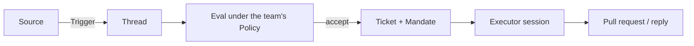

# Super Agent

**A proactive coding agent for one GitHub repository.**

Super Agent works for a whole team without consuming the whole team's attention. It listens to GitHub (and, optionally, Feishu), turns requests from people the team has allowed into tracked work, executes each request in its own agent session, and replies in the conversation where it started, usually with a pull request.

It is built on [DeepSeek Harness](https://www.deepseek.com/en/harness/).

## The idea

An agent that can act for a whole team can also waste a whole team's attention. Super Agent follows one rule:

> Take as little human attention as possible, and give as much value as possible.

So it acts only when someone asks, or when a written rule the team owns allows it. It stays quiet while it works and speaks again only when there is a result to use or a decision only a person can make.

## How it works

1. **Listen.** A Source turns an event — a GitHub mention, review or CI change, or a Feishu message — into a Trigger.
2. **Decide.** Triggers belong to Threads. An Eval checks the team's Policy: who may ask for work, and how far that work may go.
3. **Work.** An accepted request becomes a Ticket with a Mandate. The agent executes it in a dedicated session and directory, with its own branch, tests and review.
4. **Answer.** Results go back to where the request was made. When the work is merged or closed, the ticket ends.

A web panel shows only what needs a person: open questions, blocked work and results waiting for review.

## What it can do

- **GitHub** — notifications, subscribed issues and pull requests, reviews, CI results, merges and closes.
- **Feishu (optional)** — topic replies, chat history, attachments and documents.
- **Policy** — per-source allow lists, admission rules and written rules for proactive work, which can start in observation-only mode.
- **Tickets** — scoped mandates, follow-ups on the original thread, stop, retry and hand-back.
- **Isolation** — one DSH session and one directory per ticket, so work does not leak between requests.
- **Honest reporting** — work is reported back in a structured form; a draft is marked unfinished and a failure stays a failure.

## Status

Super Agent is under active development. This repository currently holds the project overview; setup, architecture and usage documentation will follow.

## Learn more

- [DeepSeek Harness](https://www.deepseek.com/en/harness/) — the agent runtime Super Agent is built on.
- [dsh-superagent-prototype](https://github.com/deepseek-ai/dsh-superagent-prototype) — the public research prototype of this design.
