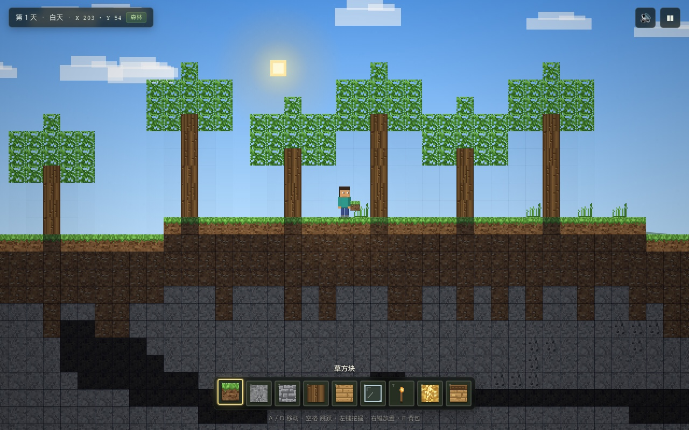
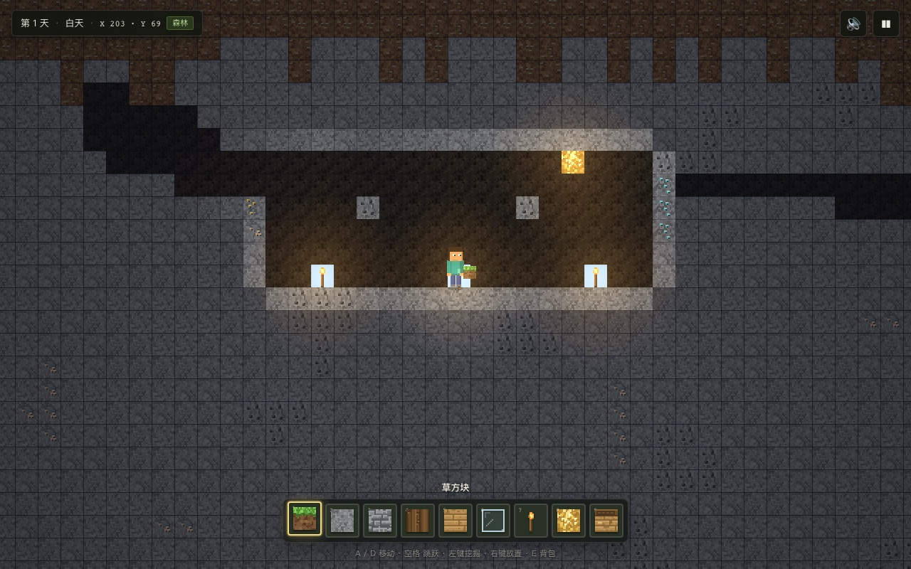

# 方块世界 2D

一个用原生 HTML5 Canvas 写的、**我的世界（Minecraft）风格的 2D 沙盒小游戏**。不用安装依赖、不用构建，双击 `index.html` 就能开始挖矿和造房子。



## 快速开始

直接双击 `index.html`；或者在当前目录起一个静态服务器（推荐）：

```bash
python3 -m http.server 8000
# 然后打开 http://localhost:8000
```

游戏需要键盘和鼠标，推荐在桌面浏览器中游玩。支持 Chrome、Edge、Firefox、Safari 的较新版本。

## 操作

| 操作 | 按键 |
| --- | --- |
| 左右移动 | `A` / `D` 或 `←` / `→` |
| 跳跃 | `空格` 或 `W` / `↑` |
| 疾跑 | 按住 `Shift` |
| 挖掘 | 按住鼠标左键（拖动可连续挖） |
| 放置方块 | 鼠标右键 |
| 切换快捷栏 | `1`–`9` 或鼠标滚轮 |
| 选择方块 | `E` 打开背包，点击方块放入当前槽位 |
| 飞行模式 | `F` |
| 静音 | `M` |
| 暂停 / 保存 | `Esc` |

对着空地右键会直接放置；对着实心方块右键时，会自动尝试放在它上面一格。摆放的位置必须空着、在 6 格范围内，而且不能卡进自己身体里。

## 这个世界里有什么

- **程序化生成的 640 × 120 格世界**：森林、平原、沙漠、雪原四种生物群系，起伏的丘陵、湖泊与沙滩。
- **洞穴与矿脉**：地下有大小洞穴、煤矿、铁矿、金矿、钻石矿和荧石。越深越危险，也越富有。
- **树木与地表装饰**：橡树、雪松、仙人掌、草丛、红花、枯灌木，附近通常能找到一棵树。
- **26 种方块**：草、泥土、石头、圆石、原木、树叶、沙子、水、基岩、各类矿石、木板、玻璃、火把、工作台、雪块、仙人掌、草丛、红花、枯灌木、荧石、砖块、砂岩、书架。
- **挖掘与建造**：按住左键有挖掘进度和裂纹；右键放置方块；粒子、屏幕轻震和程序化音效。
- **光照与昼夜**：按格计算的天光扩散、火把/荧石局部光源、洞穴黑暗；300 秒一轮的日出日落、星空、月亮和视差远景。
- **水下与飞行**：可以游泳、在湖底行走，也可以按 `F` 自由飞行和悬停。
- **浏览器存档**：世界种子、方块改动、玩家位置、时间、快捷栏与声音设置自动保存在 `localStorage`。暂停菜单里可以手动保存、重新生成世界。
- **可分享种子**：在 URL 后加 `?seed=13579` 会用指定种子开一个全新世界（会忽略本地旧存档）。启动页也能直接“换一个世界”。



## 项目结构

```text
games/minecraft-2d/
├── index.html          # 页面、开始界面、暂停与背包弹窗
├── css/style.css       # HUD、面板、按钮与响应式布局
├── js/
│   ├── noise.js        # 带种子的 PRNG、value noise、fbm
│   ├── blocks.js       # 方块属性表 + 程序化 16×16 像素贴图
│   ├── world.js        # 地形/洞穴/矿脉/树木生成、方块存取、天光
│   ├── player.js       # AABB 碰撞、跳跃/游泳/飞行、行走动画状态
│   ├── audio.js        # WebAudio 合成音效
│   ├── renderer.js     # 天空、云、远景、方块、玩家、光照、粒子
│   ├── ui.js           # 快捷栏、背包、暂停、开始界面
│   └── game.js         # 主循环、输入、挖掘/放置、存档
└── docs/               # README 截图
```

加载方式是最普通的 `<script>`，没有模块、打包器或第三方依赖，因此 `file://` 直接打开也能工作。所有贴图在运行时用 Canvas 生成，没有外部图片和字体请求。

## 技术细节

- **世界生成**：多层 value-noise/fBm 决定高度与生物群系；洞穴由 2D fBm 阈值和隧道带组合而成；矿脉用带种子的随机游走生成。
- **光照**：预计算全图天光（从顶部向下传播 + 横向扩散），渲染时叠加视野内火把/荧石的局部光照。天光强度随昼夜变化，火把带暖色光晕。
- **渲染**：摄像机按整数像素取整，16×16 像素贴图放大到 32px 并关闭插值；每个方块贴图有 1–3 个随机变体，避免大面积重复。
- **物理**：0.18 格步进的轴分离碰撞、土狼时间与跳跃缓冲、水中浮力、飞行模式。
- **存档**：只保存相对种子的方块改动（`x,y → id`）与玩家状态，存档体积远小于整张地图。

## 已知限制

- 这是**创造模式沙盒**：方块无限，没有生命、饥饿、合成、工具耐久或生物。
- 没有触屏操作；手机上会显示桌面游玩提示。
- 存档在本浏览器本地，换浏览器/设备或清理站点数据后不会保留。
- 世界宽 640 格，目前没有无限横向扩展。
- 水是静态方块，不会流动，也不会自动填坑。

这是一个非官方作品，与 Mojang / Microsoft 无关；“我的世界（Minecraft）”相关名称属于其权利人。
